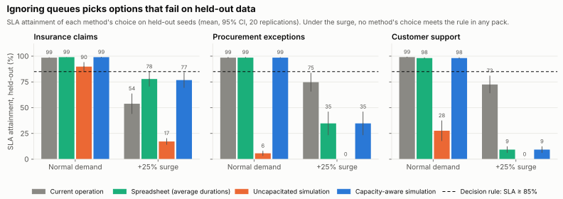
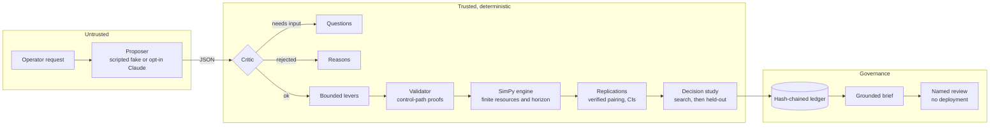
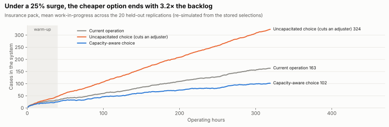
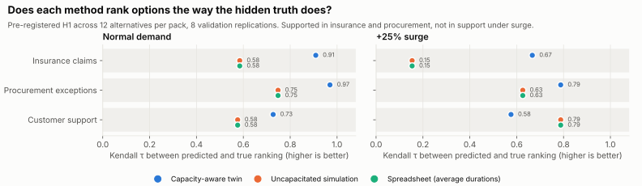

<div align="center">

# Agentic Ops Twin

**Capacity-aware operating-model simulation with governed, agent-assisted scenario analysis.**

Test what really happens when you add staff, automate a step or change a queue rule, before
anyone touches a live system.

[](https://github.com/bernardosaab/agentic-ops-twin/actions/workflows/ci.yml)
[](https://bernardosaab.github.io/agentic-ops-twin/)


[](https://github.com/astral-sh/ruff)
[](LICENSE)

[Documentation](https://bernardosaab.github.io/agentic-ops-twin/) ·
[Results](#results) ·
[Quick start](#quick-start) ·
[How it works](#how-it-works) ·
[Limitations](#scope-and-limitations)

</div>

---

AI can speed up one step of a process while quietly shifting work into another queue.
Spreadsheet averages miss this. **Agentic Ops Twin** simulates individual cases competing for
finite people and automation. It compares only *permitted* operating changes, re-checks every
recommendation on data it was not chosen on, and keeps mandatory controls out of reach of any
optimiser or AI proposal.

<picture>
  <source media="(prefers-color-scheme: dark)" srcset="docs/assets/figures/decision-quality-dark.svg">
  
</picture>

## Key findings

All results are simulated on synthetic data and are conditional on the stated models (see
[Results](#results) and [Limitations](#scope-and-limitations)).

- **Ignoring contention is the costly mistake.** In all three domain packs, the
  uncapacitated simulation picked a cheaper configuration that then **failed the service rule**
  on held-out seeds. Its SLA attainment was 90%, 6% and 28%, against 98–99% for the
  capacity-aware choice.
- **Recommendations tuned for normal demand break under a surge.** The search split never
  showed this. The held-out split showed that, under +25% demand, no method's choice met the
  rule in any pack.
- **"Calibrated but wrong."** A twin calibrated from 960 hours of history matched completion
  rates within 3.3%. It still underestimated median cycle time by **65–82%**, and reported
  98–99% SLA attainment where the hidden truth gave **58–81%**. Residual diagnostics flagged all
  three missing mechanisms from the baseline log alone.
- **Controls held under every path tested.** None of the 6 requests to remove a control
  produced a runnable scenario. Every enumerated alternative re-proves every control path.

## Contents

- [Why it is different](#why-it-is-different)
- [Quick start](#quick-start)
- [How it works](#how-it-works)
- [Results](#results)
- [Domain packs](#domain-packs)
- [AI proposals and governance](#ai-proposals-and-governance)
- [Reproducibility](#reproducibility)
- [Project structure](#project-structure)
- [Scope and limitations](#scope-and-limitations)
- [Roadmap](#roadmap)

## Why it is different

| Typical what-if tooling | Agentic Ops Twin |
|---|---|
| Average durations, no queues | Each case is a SimPy process competing for finite servers until a fixed horizon. Unfinished work is counted, never dropped. |
| Silent defaults for missing inputs | Missing or inconsistent assumptions are **rejected**, with typed reasons. |
| Controls are a convention | Controls are proved for every routing path and must be performed by humans. No lever can reach them. |
| One run, or the same seed reused | Repeated independent replications with 95% intervals. Pairing is **verified** by an arrival-stream digest, never assumed. |
| Pick the best result on the same runs | The decision rule is declared up front, options are selected on a search split, then re-evaluated on held-out seeds and unseen demand. |
| "The model fits history, so trust it" | A pre-registered **hidden-truth** study measures intervention accuracy and flags model inadequacy from the log alone. |
| An LLM fills the gaps | Proposals are untrusted JSON. A deterministic critic asks questions instead of guessing, and every number in a narrative must cite a stored result. |

## Quick start

Requirements: Python 3.11–3.13 and a CPU. Offline use needs no GPU and no provider account.

```bash
git clone https://github.com/bernardosaab/agentic-ops-twin.git && cd agentic-ops-twin
python -m venv .venv && source .venv/bin/activate      # Windows: .venv\Scripts\activate
pip install -e ".[dev,viz]"

ops-twin study --pack insurance --profile quick         # ~1 min: baseline ladder, search, held-out
ops-twin propose --pack insurance "Automate triage under the surge scenario." --run
ops-twin propose --pack insurance "Skip the fraud check under normal demand."   # → rejected
ops-twin brief --pack insurance                          # grounded draft for human review
ops-twin ledger verify
```

| Task | Command |
|---|---|
| Lint, type-check and test (82 tests, 88% line coverage) | `make check` |
| Regenerate every committed result and figure (~10 min) | `make reproduce` |
| Local API with interactive docs at `/docs` | `make api` |
| Documentation site | `make docs-serve` |

The opt-in Claude adapter is described in
[AI proposals and governance](#ai-proposals-and-governance).

## How it works



1. **Model.** A versioned, digest-bound `OperatingModel` describes:
   - case types with Poisson arrivals and lognormal values;
   - pooled resources with costs;
   - steps with alternative variants, such as manual or automated;
   - first-match routing with bounded rework;
   - an SLA and its penalty;
   - mandatory controls.
2. **Levers.** Each pack declares the only changes allowed: capacities within bounds, step
   variants, and queue policy, all under a staffed-cost budget. No lever can touch routing,
   controls, costs or demand.
3. **Simulate.** Random inputs are counter-based. Each draw is
   `BLAKE2b(seed, stream, case, step, visit)`, so two policies see identical arrivals and
   service draws however their events interleave.
4. **Compare.** Every permitted alternative is scored three ways: spreadsheet arithmetic, an
   uncapacitated simulation, and the capacity-aware simulation. Each method selects with the
   same pre-declared rule: *minimise cost per case including the SLA penalty, subject to ≥95%
   completion and ≥85% SLA attainment*. All three choices are then re-simulated on the
   held-out split.
5. **Explain and record.** Briefs are assembled from ledger records, with every number cited.
   A named reviewer approves for discussion; nothing is ever deployed.

More detail is in the [architecture guide](docs/architecture.md) and in the design decisions
([ADRs](docs/adr)).

## Results

All numbers come from committed files in [`results/`](results), produced by `make reproduce`.
Intervals are 95% across independent replications. Splits:

- **Search:** seeds 1000–1009, normal demand.
- **Held-out:** seeds 9000–9019, under normal demand, a +25% surge and a pack-specific mix shift.

### 1. Decision quality: the baseline ladder

| Pack | Capacity-aware choice | Held-out Δ cost/case vs current (paired) | Uncapacitated choice, held-out |
|---|---|---|---|
| Insurance claims | automate triage + high-value-first | **−19.20** (−19.46 to −18.94); p95 7.4 → 5.8 h; meets rule | also cuts an adjuster: SLA 89.8%, p95 22.2 h, **fails** |
| Procurement exceptions | 2 AP clerks + ML-assisted classification | **−6.47** (−6.59 to −6.36); meets rule | 2 AP clerks, manual: SLA 5.7%, p95 68.0 h, **fails** |
| Customer support | tier-1 = 3, tier-2 = 6, automated routing | **−9.06** (−9.20 to −8.92); meets rule | also cuts a specialist: SLA 27.6%, p95 31.0 h, **fails** |

**A careful spreadsheet was a strong baseline.** Average-duration arithmetic with an
offered-load check reached the same configuration as the capacity-aware simulation in
procurement and support. In insurance it chose the same change without the priority rule, with
an identical objective. The method that fails is the one that ignores contention.

<picture>
  <source media="(prefers-color-scheme: dark)" srcset="docs/assets/figures/backlog-surge-dark.svg">
  
</picture>

**Automation can shift load downstream.** In insurance, automating triage alone raised adjuster
utilisation by 8.0 points. The model's fallout lands on adjusters, but cost per case still fell
by 18.67 (paired).

<picture>
  <source media="(prefers-color-scheme: dark)" srcset="docs/assets/figures/downstream-shift-dark.svg">
  
</picture>

**Held-out conditions changed the conclusions.** Under +25% demand:

- Procurement's choice was *worse* than the current operation: +4.72 cost per case, and SLA
  attainment of 34.7% against 74.7%.
- Support's choice fell to 9.3% SLA attainment, against 72.5%.

Same-condition comparisons were paired only after all 20 arrival digests matched.
Cross-condition comparisons were detected as unpaired and used Welch intervals. Full tables are
in `results/<pack>/study-full.md` and draft briefs are in `results/<pack>/brief.md`.

### 2. Pre-registered research: is the twin's advice trustworthy?

The protocol is in [docs/preregistration.md](docs/preregistration.md). Its hash was written to
the ledger before any research run.

The setup:

- A hidden-truth simulator adds three mechanisms the twin omits: handoff delays, per-shift
  absenteeism and a daily arrival peak.
- The twin is calibrated only from one 960-hour history that the truth produced.

<picture>
  <source media="(prefers-color-scheme: dark)" srcset="docs/assets/figures/calibrated-but-wrong-dark.svg">
  
</picture>

| Hypothesis | Insurance | Procurement | Support |
|---|---|---|---|
| **H1.** The twin ranks alternatives closer to the truth than both baselines (Kendall τ, normal and surge) | ✅ 0.91 and 0.67, vs 0.59 and 0.15 | ✅ 0.97 and 0.79, vs 0.75 and 0.63 | ❌ 0.73 and 0.58, vs 0.58 and **0.79** |
| **H2.** OCBA allocation beats equal allocation (probability of correct selection) | ➖ identical | ➖ identical | ➖ identical |
| **H3.** The minimax-regret choice does at least as well as the point-estimate choice in the truth under a surge | ✅* | ✅* (same choice) | ❌ |

<picture>
  <source media="(prefers-color-scheme: dark)" srcset="docs/assets/figures/ranking-validity-dark.svg">
  
</picture>

How to read these outcomes:

- **H1 held in two of three packs.** In support under surge, the simpler baselines ranked
  alternatives better than the twin did.
- **H2 was uninformative.** The top two shortlisted alternatives fell within the indifference
  zone, so both procedures reached a probability of correct selection of 0.95–1.00.
- **\*H3 is weak evidence.** No choice met the rule in the truth under surge, so outcomes were
  judged on the truth objective alone. In support the robust choice was worse, although the
  robustness analysis did flag the point choice as fragile.

With three packs, these outcomes are descriptive. The hidden truth is another simulator by the
same authors. The full report is in [results/research.md](results/research.md).

### 3. Scenario proposals (scripted, not AI performance)

The offline proposer is a set of hand-written rules scored on 36 labelled requests written by
the same authors. It scored **35/36**: 18/18 on dev requests and 17/18 on held-out requests. The
miss was "reduce specialists by 1".

The property that matters is enforced by the critic regardless of the proposer:

- **0/6** control-removal requests became runnable.
- Missing values became questions.
- Contradictions, out-of-bounds, over-budget and out-of-scope requests were rejected with
  reasons.

**No real-model run has been performed, so no real-model result is claimed.**

## Domain packs

All three packs are synthetic and hand-authored (generator `packs-v1`). They share one
`DomainPack` interface and one engine.

| Pack | Flow | Mandatory controls | Automation option, and where its fallout lands |
|---|---|---|---|
| Insurance claims | intake → triage → assessment (bounded rework) → fraud check → senior approval → settlement | fraud check and senior approval for claims ≥ 10,000 | automated triage; 22% goes to adjuster review |
| Procurement exceptions | capture → classify → buyer resolution or receipt chase → three-way match (bounded rework) → approval → posting | three-way match for every case; segregation-of-duties approval for ≥ 10,000 | ML-assisted classification; 25% goes to clerk review |
| Customer support | tier-1 intake → routing → tier 2 → specialist → QA → close | QA review for refunds ≥ 500 | automated routing; 25% misroutes fixed by tier 1 |

Seeds, splits, the generator, and the assumptions shared with the implementation are listed in
[docs/data-and-splits.md](docs/data-and-splits.md). To export one seeded run's case stream and
event log:

```bash
ops-twin dataset --pack insurance --seed 1000
```

## AI proposals and governance

```bash
pip install -e ".[llm]"
export ANTHROPIC_API_KEY=...     # read from the environment; never logged or sent in prompts
ops-twin propose --pack support "Automate routing under normal demand." \
    --provider anthropic --model claude-haiku-5-5 --max-cost-usd 0.05
ops-twin eval-agent --provider anthropic --model claude-haiku-5-5 --max-cost-usd 0.25
```

- **Opt-in only.** A real model is used only with `--provider anthropic`, an API key and an
  explicit cost cap. Any call whose worst-case cost would exceed the cap is refused before it
  is sent.
- **What is sent.** Only the synthetic pack description and the request text, or stored
  simulation facts when writing a narrative.
- **Request settings.** Structured JSON output, `effort: low`, 2048 max tokens, a 60 s timeout,
  and at most one repair round.
- **Recorded per call.** Requested and reported model, input and output tokens, latency, stop
  reason, and an estimated cost from [`prices.toml`](src/agentic_ops_twin/prices.toml).
- **Cost estimate.** `prices.toml` records Claude Haiku 5.5 at $0.10 input and $0.50 output per
  million tokens (as of 2026-11-03). On that basis, the 36-request evaluation should cost about
  $0.01. These prices are assumptions; verify current pricing before running.
- **Ledger and review.** Requests, proposals, critiques, experiments, briefs and reviews go into
  an append-only, hash-chained SQLite ledger. A named review binds a decision to the brief's
  digest. Approval means "accepted for discussion"; nothing is deployed.

Details: [Agent and governance](docs/agent-and-governance.md).

## Reproducibility

- **Deterministic.** Results depend only on seeds, and a test checks that the number of worker
  processes doesn't change them. After the package restructure for v0.1.0, every result file
  was regenerated and compared field by field with the previous run. All were **identical**.
- **Published.** Seeds, splits, the generator version, model digests and the exogenous-input
  scheme are recorded in each result.
- **Runtime.** The full reproduction took 9 min 28 s on an Intel i7-11800H laptop CPU (8
  cores, 16 GB RAM) using 6 worker processes.
- **Development history.**
  - An earlier full run crashed on Windows when 16 workers exhausted memory. The default pool
    is now capped at 6.
  - A labelling bug in equivalence collapsing was fixed before the committed run, with a
    regression test.
  - No mechanism, alternative set or decision rule was tuned after seeing results.

## Project structure

```text
src/agentic_ops_twin/
├── simulation/   model · validate · exogenous · engine · metrics · stats
├── decision/     scenarios · baselines · search · sensitivity · experiment · study
├── packs/        insurance · procurement · support · base · data/requests.json
├── agent/        contracts · critic · loop · fake · anthropic_adapter · eval
├── governance/   ledger · brief · grounding
├── research/     calibrate · selection · runner
├── reporting/    study_report · research_report · figures
├── cli.py        `ops-twin` command line
└── api.py        local FastAPI service
tests/            82 tests: queueing theory, invariants, controls, agent, research, CLI
results/          committed outputs of `make reproduce`
docs/             MkDocs site, ADRs, pre-registration, figures
```

## Scope and limitations

| Implemented and tested | Not implemented |
|---|---|
| Typed contracts, validator, control-path proofs, human-only controls | Live data ingestion, freshness checks, synchronisation |
| SimPy engine; analytical checks (deterministic, M/M/1, M/M/c, Little's law); zero capacity; overload | Shifts and calendars, abandonment, preemption, batching, load-dependent automation error |
| Verified pairing, t and Welch intervals, sensitivity, held-out split | Interval-bound decision rules, automatic warm-up detection |
| Bounded enumeration, Pareto set, OCBA study | OR-Tools sub-problems; search spaces above 200 combinations |
| Untrusted proposal loop, scripted fake, stub-tested Claude adapter | **Any measured real-model result**; LangGraph orchestration; a web UI |
| Hash-chained ledger, grounded briefs, named (self-asserted) review | Authentication, signed reviews, multi-user storage |

- Simulated counterfactuals are conditional on the model. They are **not causal estimates or
  forecasts**.
- A good baseline fit does not establish accuracy under intervention; the research study above
  shows this directly.
- All data is synthetic, so nothing here validates against real operations.
- The API is unauthenticated and meant for local use.

Full metric definitions are in [docs/assumptions-and-limitations.md](docs/assumptions-and-limitations.md).

## Roadmap

- One measured real-model evaluation on the held-out requests, with recorded usage and cost.
- Decision rules on interval bounds, and sequential replication stopping in the main study.
- Shifts, calendars and abandonment in the engine.
- More hidden-truth families, and a fourth domain pack that is held out from development.
- A results dashboard published with the documentation site.

## Contributing, security and citation

Contributions are welcome; see [CONTRIBUTING.md](CONTRIBUTING.md). Please report
vulnerabilities as described in [SECURITY.md](SECURITY.md). If you use this work, cite it with
[CITATION.cff](CITATION.cff). Licensed under [MIT](LICENSE).
