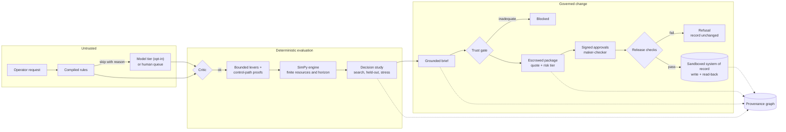
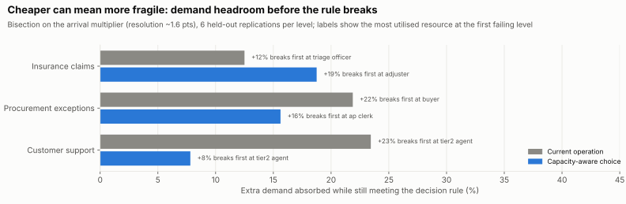
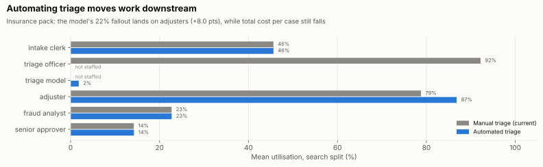
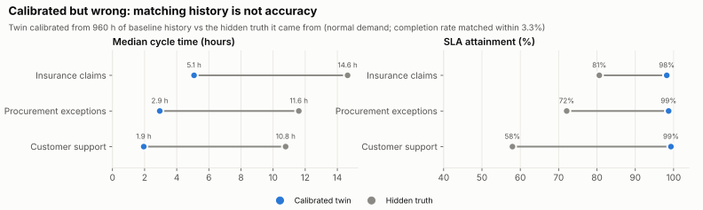

<div align="center">

# Agentic Ops Twin

**Capacity-aware operating-model simulation, wrapped in a deterministic harness for governed,
agent-assisted change.**

Test what really happens when you add staff, automate a step or change a queue rule. Find out
what breaks if the assumptions are wrong, and let a change reach a system of record only through
signed approvals and verified write-back.

[](https://github.com/bernardosaab/agentic-ops-twin/actions/workflows/ci.yml)
[](https://bernardosaab.github.io/agentic-ops-twin/)


[](https://github.com/astral-sh/ruff)
[](LICENSE)

[Documentation](https://bernardosaab.github.io/agentic-ops-twin/) ·
[Results](#results) ·
[Quick start](#quick-start) ·
[How it works](#how-it-works) ·
[The harness](#the-deterministic-harness) ·
[Limitations](#scope-and-limitations)

</div>

---

AI can speed up one step of a process while quietly shifting work into another queue.
Spreadsheet averages miss this, and a model that "fits history" can still be badly wrong about
an intervention.

**Agentic Ops Twin** simulates individual cases competing for finite people and automation. It
compares only *permitted* changes and re-checks every recommendation on held-out data. It also
stress-tests each recommendation for what breaks first. Everything around the model is
deterministic, from proposal to write-back:

- compiled rules run first, and skip with a reason rather than guess;
- a critic and control-path proofs check every proposal;
- a trust gate checks the twin against observed history;
- changes are escrowed with signed, payload-bound approvals;
- every write is read back;
- a bi-temporal provenance graph lets an auditor reconstruct any decision.

<picture>
  <source media="(prefers-color-scheme: dark)" srcset="docs/assets/figures/decision-quality-dark.svg">
  
</picture>

## Key findings

All results are simulated on synthetic data and are conditional on the stated models (see
[Results](#results) and [Limitations](#scope-and-limitations)).

- **Ignoring contention is the costly mistake.** In all three domain packs, the uncapacitated
  simulation picked a cheaper configuration that then **failed the service rule** on held-out
  seeds. Its SLA attainment was 90%, 6% and 28%, against 98–99% for the capacity-aware choice.
- **Cheaper can mean more fragile.** The stress test measures *demand headroom*: how much extra
  demand an option absorbs before it breaks the decision rule.

  | Pack | Current operation | Cost-optimal choice |
  |---|---|---|
  | Procurement | +22% | **+16%** |
  | Support | +23% | **+8%** |
  | Insurance | +12% | **+19%**, but the bottleneck moves from triage officers to adjusters |

- **"Calibrated but wrong."** A twin calibrated from 960 hours of history matched completion
  rates within 3.3%. It still underestimated median cycle time by **65–82%**. Residual
  diagnostics flagged every missing mechanism, and the **trust gate now blocks release** in that
  situation.
- **The harness passes its own adversarial evaluation.** It passed **14/14** golden jobs and
  negative tests. Forged, expired, self-signed, insufficient, stale or replayed approvals were
  all refused, and in every case the system of record was left **byte-for-byte unchanged**. The
  compiled routing path gave **0 wrong answers** on 36 labelled requests: it answered 34
  correctly and sent 2 to a human queue instead of guessing.

## Contents

- [Why it is different](#why-it-is-different)
- [Quick start](#quick-start)
- [How it works](#how-it-works)
- [The deterministic harness](#the-deterministic-harness)
- [Results](#results)
- [Domain packs](#domain-packs)
- [Opt-in real model](#opt-in-real-model)
- [Reproducibility](#reproducibility)
- [Project structure](#project-structure)
- [Scope and limitations](#scope-and-limitations)
- [Roadmap](#roadmap)

## Why it is different

| Typical what-if or agent tooling | Agentic Ops Twin |
|---|---|
| Average durations, no queues | Each case is a SimPy process competing for finite servers until a fixed horizon. Unfinished work is counted, never dropped. |
| One recommended option | Options are selected on a search split and re-evaluated on held-out seeds and unseen demand. Each one is **stress-tested for headroom and for what breaks first**. |
| "The model fits history, so trust it" | Residual diagnostics classify the twin as validated, unvalidated or inadequate. An inadequate twin **cannot release a change**. |
| Controls are a convention | Controls are proved for every routing path and must be performed by humans. No lever, proposal or optimiser can reach them. |
| The LLM fills the gaps | Compiled rules run first and **skip with a reason** instead of guessing. Model tiers are opt-in, cheapest first, with a shadow mode. Every proposal passes a deterministic critic. |
| "Ask before you write" in a prompt | Writes are escrowed with a field-level quote and released only with HMAC approvals over the exact payload hash, under maker-checker rules. The write is then **read back**. |
| Chat logs as audit trail | A hash-chained, bi-temporal provenance graph: typed edges, invalidate-not-delete, as-of queries, and exportable **reconstruction packs**. |
| Model evaluation only | **Harness evaluation** (golden jobs and negative tests) is reported separately from **model evaluation**, and routing reports correct, wrong and skipped counts. |

## Quick start

Requirements: Python 3.11–3.13 and a CPU. Offline use needs no GPU and no provider account.

```bash
git clone https://github.com/bernardosaab/agentic-ops-twin.git && cd agentic-ops-twin
python -m venv .venv && source .venv/bin/activate      # Windows: .venv\Scripts\activate
pip install -e ".[dev,viz]"

ops-twin study --pack insurance --profile quick         # baseline ladder, search, held-out (~1 min)
ops-twin brief --pack insurance                          # grounded brief + breaking-point stress test
ops-twin trust --pack insurance                          # model trust gate -> trust record id
ops-twin reviewer add approver-a && ops-twin reviewer add approver-b
ops-twin package --pack insurance --brief <brief-id> --trust <trust-id> --maker ops-analyst
ops-twin approve --package <package-id> --reviewer approver-a --acknowledge-unvalidated
ops-twin approve --package <package-id> --reviewer approver-b --acknowledge-unvalidated
ops-twin release --pack insurance --package <package-id> --requester ops-analyst
ops-twin ledger reconstruct --record <release-id>        # auditor's reconstruction pack
```

| Task | Command |
|---|---|
| Lint, type-check and test (93 tests, 86% line coverage) | `make check` |
| Regenerate every committed result, report and figure (~9 min) | `ops-twin reproduce` |
| Harness evaluation: golden jobs and negative tests | `ops-twin eval-harness` |
| Local API with interactive docs at `/docs` | `make api` |
| Documentation site | `make docs-serve` |

## How it works



1. **Model.** A versioned, digest-bound `OperatingModel` describes:
   - case types with their arrivals and values;
   - pooled resources with costs;
   - steps with variants, such as manual or automated;
   - routing with bounded rework;
   - an SLA and its penalty;
   - the mandatory controls.
2. **Levers.** Each pack declares the only permitted changes: capacities within bounds, step
   variants and queue policy, all under a budget. No lever can touch routing, controls, costs or
   demand.
3. **Simulate and compare.**
   - Counter-based random inputs give policies identical arrivals and service draws, and that
     pairing is **verified** by digest.
   - Every permitted alternative is scored three ways: spreadsheet arithmetic, an uncapacitated
     simulation and the capacity-aware simulation.
   - Each method selects with the same pre-declared rule. All choices are re-simulated on a
     held-out split.
4. **Stress.** A bisection on demand finds each option's **headroom**, the binding constraint,
   and the resource that **breaks first**.
5. **Govern the change.** Briefs cite stored facts only. A change reaches the sandboxed system of
   record only through the trust gate, escrow, signed approvals, release checks and read-back.
   Every step is recorded in the provenance graph.

More detail: [architecture](docs/architecture.md), [the deterministic harness](docs/harness.md),
and the [design decisions](docs/adr).

## The deterministic harness

| Layer | Implementation |
|---|---|
| Feedforward guides | The proposer sees only the pack's lever schema, bounds, current values, demand conditions and control names, and must answer in strict JSON. |
| Compiled path first | Deterministic rules handle known request shapes. A request with no matching rule, or with a quantity the rules can't account for, is **skipped** and escalated. |
| Model routing | Opt-in tiers, cheapest first, with escalation only on a skip. Shadow mode records whether a second proposer agrees, without affecting outcomes. |
| Computational sensors | Schema validation, the critic, control-path proofs, budget and bounds checks, number-level grounding, digest checks, token checks and read-back. None of these is an LLM judge. |
| Model trust gate | Validated: the standard tiers apply. Unvalidated: high-risk path, acknowledged by every approver. Inadequate: blocked. |
| Write-gate | Escrow, a field-level quote, a policy-set risk tier, HMAC tokens over the payload hash, maker-checker approval with two approvers for high-risk changes, fail-closed release and read-back. |
| Provenance graph | Append-only and hash-chained, with typed edges, valid and transaction time, invalidate-not-delete, as-of queries and reconstruction packs. |
| Evaluation | Harness evaluation (golden jobs and negative tests) is separate from routing evaluation and model evaluation. |

Details: [docs/harness.md](docs/harness.md).

## Results

All numbers come from committed files in [`results/`](results), produced by `ops-twin reproduce`.
Intervals are 95% across independent replications. Splits:

- **Search:** seeds 1000–1009, normal demand.
- **Held-out:** seeds 9000–9019, under normal demand, a +25% surge and a pack-specific mix shift.

### 1. Decision quality: the baseline ladder

| Pack | Capacity-aware choice | Held-out Δ cost per case vs current (paired) | Uncapacitated choice, held-out |
|---|---|---|---|
| Insurance claims | automate triage + high-value-first | **−19.20** (−19.46 to −18.94); p95 7.4 → 5.8 h; meets rule | also cuts an adjuster: SLA 89.8%, p95 22.2 h, **fails** |
| Procurement exceptions | 2 AP clerks + ML-assisted classification | **−6.47** (−6.59 to −6.36); meets rule | 2 AP clerks, manual: SLA 5.7%, p95 68.0 h, **fails** |
| Customer support | tier-1 = 3, tier-2 = 6, automated routing | **−9.06** (−9.20 to −8.92); meets rule | also cuts a specialist: SLA 27.6%, p95 31.0 h, **fails** |

A careful spreadsheet (average-duration arithmetic with an offered-load check) was a strong
baseline. It reached the capacity-aware configuration in procurement and support, and the same
objective in insurance. The method that fails is the one that ignores contention.

### 2. What breaks when the assumption is wrong

<picture>
  <source media="(prefers-color-scheme: dark)" srcset="docs/assets/figures/headroom-dark.svg">
  
</picture>

The cost-optimal choice wins at today's demand. Its margin against demand error differs
sharply by pack:

| Pack | Margin against demand error | First thing to break |
|---|---|---|
| Insurance | Larger (+19% vs +12%) | The bottleneck **moves** from triage officers to adjusters, as automation fallout lands on them. |
| Procurement | Smaller (+16% vs +22%) | AP clerks |
| Support | Much smaller (+8% vs +23%) | Tier-2 agents |

This agrees with the held-out surge results. Under +25% demand:

- procurement's choice falls to 34.7% SLA attainment, against 74.7% for the current operation;
- support's choice falls to 9.3%, against 72.5%.

Every brief now reports this table next to the cost result, so a reviewer sees what the
recommendation trades away.

<picture>
  <source media="(prefers-color-scheme: dark)" srcset="docs/assets/figures/backlog-surge-dark.svg">
  
</picture>

<picture>
  <source media="(prefers-color-scheme: dark)" srcset="docs/assets/figures/downstream-shift-dark.svg">
  
</picture>

### 3. Pre-registered research: is the twin's advice trustworthy?

The protocol is in [docs/preregistration.md](docs/preregistration.md); its hash was written to
the ledger before any research run. A hidden-truth simulator adds three mechanisms the twin
omits: handoff delays, absenteeism and a daily arrival peak. The twin is calibrated only from
960 hours of history that the truth produced.

<picture>
  <source media="(prefers-color-scheme: dark)" srcset="docs/assets/figures/calibrated-but-wrong-dark.svg">
  
</picture>

| Hypothesis | Insurance | Procurement | Support |
|---|---|---|---|
| **H1.** The twin ranks alternatives closer to the truth than both baselines (Kendall τ, normal and surge) | ✅ 0.91 and 0.67, vs 0.59 and 0.15 | ✅ 0.97 and 0.79, vs 0.75 and 0.63 | ❌ 0.73 and 0.58, vs 0.58 and **0.79** |
| **H2.** OCBA beats equal replication allocation | ➖ identical | ➖ identical | ➖ identical |
| **H3.** The minimax-regret choice does at least as well as the point estimate in the truth under surge | ✅* | ✅* (same choice) | ❌ |

- **H2 was uninformative.** The top two shortlisted alternatives fell within the indifference
  zone.
- **\*H3 is weak evidence.** No choice met the rule in the truth under surge, so H3 was judged
  on the objective alone.
- With three packs, all of this is descriptive, and the hidden truth is another simulator by the
  same authors.

Full report: [results/research.md](results/research.md).

### 4. Harness evaluation: governed write-back

[results/harness/eval-insurance.md](results/harness/eval-insurance.md) records **14/14** passes.
Each case runs in an isolated workspace.

| Golden jobs (must write, then read back) | Negative tests (must refuse, record unchanged) |
|---|---|
| G1: high-risk change from an unvalidated twin, with two acknowledging approvers | No approval · one approval on a high-risk package · self-approval · forged tokens · expired tokens |
| G2: the same change from a validated twin | Unacknowledged unvalidated twin · inadequate twin (trust gate) · brief invalidated after approval |
| | System of record drifted after the quote · one approver rejects · replay of a released package · request to remove a control |

The golden release's [reconstruction pack](results/harness/golden-release-reconstruction.md)
links all 9 records, from request to verified release, with a verified hash chain.

### 5. Routing and scenario proposals (compiled rules, not AI performance)

[results/agent/routing-compiled.md](results/agent/routing-compiled.md) covers 36 labelled
requests:

- **34 correct, 0 wrong, 2 skipped** to a human queue.
- One skip was "reduce specialists by 1", which the rules couldn't fully read, so the quantity
  was unexplained. The other was a request no rule recognised.
- **0/6** control-removal requests became runnable.

The rules and the requests share authors, so this measures the routing harness, not AI
capability. **No real-model run has been performed, so no real-model result is claimed.**

## Domain packs

| Pack | Flow | Mandatory controls | Automation option, and where its fallout lands |
|---|---|---|---|
| Insurance claims | intake → triage → assessment (bounded rework) → fraud check → senior approval → settlement | fraud check and senior approval for claims ≥ 10,000 | automated triage; 22% goes to adjuster review |
| Procurement exceptions | capture → classify → buyer or receipt chase → three-way match (bounded rework) → approval → posting | three-way match for every case; segregation-of-duties approval for ≥ 10,000 | ML-assisted classification; 25% goes to clerk review |
| Customer support | tier-1 intake → routing → tier 2 → specialist → QA → close | QA review for refunds ≥ 500 | automated routing; 25% misroutes fixed by tier 1 |

All three packs are synthetic and hand-authored. Seeds, splits and the generator are documented
in [docs/data-and-splits.md](docs/data-and-splits.md).

## Opt-in real model

```bash
pip install -e ".[llm]"
export ANTHROPIC_API_KEY=...     # read from the environment; never logged or sent in prompts
ops-twin propose --pack support "Automate routing under normal demand." \
    --provider anthropic --model claude-haiku-5-5 --max-cost-usd 0.05
ops-twin eval-routing --provider anthropic --model claude-haiku-5-5 --max-cost-usd 0.25
```

- **When the model is used.** It is a routing tier, used only for requests the compiled rules
  skip, and only with an explicit cost cap.
- **What is sent.** Only the synthetic pack schema and the request text.
- **What is recorded.** Model identifiers, tokens, latency and stop reason, plus an estimated
  cost from [`prices.toml`](src/agentic_ops_twin/prices.toml).
- **Cost.** At the recorded price for Claude Haiku 5.5 ($0.10 input and $0.50 output per million
  tokens, as of 2026-11-03), a full evaluation should cost about one cent. Verify current prices
  before running.

## Reproducibility

- **Deterministic.** Results depend only on seeds, and worker count does not change them
  (tested). After each refactor, every pre-existing result file was regenerated and compared
  field by field with the previous run. All were **identical**.
- **One command.** `ops-twin reproduce` regenerates everything from a fresh ledger. The last full
  run took 9 min 3 s on an Intel i7-11800H laptop CPU (8 cores) with 6 workers.
- **Development history.**
  - An early full run crashed when 16 workers exhausted memory on Windows; the default pool is
    now capped at 6.
  - A labelling bug in equivalence collapsing was fixed, with a regression test.
  - No mechanism, alternative set or decision rule was tuned after seeing results.

## Project structure

```text
src/agentic_ops_twin/
├── simulation/   model · validate · exogenous · engine · metrics · stats
├── decision/     scenarios · baselines · search · sensitivity · stress · experiment · study
├── packs/        insurance · procurement · support · base · data/requests.json
├── agent/        contracts · critic · loop · router · fake · anthropic_adapter · eval
├── governance/   ledger · brief · grounding · trust · writegate · harness_eval
├── research/     calibrate · selection · runner
├── reporting/    study_report · research_report · figures
├── cli.py        `ops-twin` command line
└── api.py        local FastAPI service
tests/            93 tests: queueing theory, invariants, controls, agent, routing, write-gate,
                  provenance, research, CLI
results/          committed outputs of `ops-twin reproduce`
docs/             MkDocs site, ADRs, pre-registration, figures
```

## Scope and limitations

| Implemented and tested | Not implemented |
|---|---|
| SimPy engine; analytical checks (deterministic, M/M/1, M/M/c, Little's law); zero capacity; overload | Shifts and calendars, abandonment, preemption, batching, load-dependent automation error |
| Verified pairing, held-out split, sensitivity, breaking-point stress tests | Interval-bound decision rules, automatic warm-up detection |
| Trust gate, escrowed write-gate, read-back, refusals, bi-temporal provenance graph | A connection to any live system (the system of record is a local sandbox file) |
| HMAC approval tokens and maker-checker rules (illustrative identities) | Authentication, a key-management service, multi-user storage |
| Compiled-first routing, opt-in model tiers, shadow mode (stub-tested) | **Any measured real-model result**; a web UI |

- Simulated counterfactuals are conditional on the model. They are **not causal estimates or
  forecasts**.
- All data is synthetic, so nothing here validates against real operations.
- The API is unauthenticated and meant for local use.

See [docs/assumptions-and-limitations.md](docs/assumptions-and-limitations.md).

## Roadmap

- One measured real-model routing evaluation on the held-out requests, with recorded usage and
  cost.
- Promotion of shadow-mode agreements into compiled rules, with a reviewed rule diff.
- Decision rules on interval bounds; shifts, calendars and abandonment in the engine.
- More hidden-truth families, and a fourth domain pack held out from development.

## Contributing, security and citation

Contributions are welcome; see [CONTRIBUTING.md](CONTRIBUTING.md). Please report vulnerabilities
as described in [SECURITY.md](SECURITY.md). If you use this work, cite it with
[CITATION.cff](CITATION.cff). Licensed under [MIT](LICENSE).
