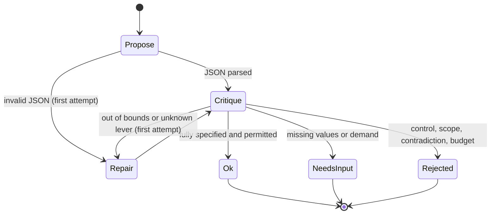

# Agent and governance

## Proposals are untrusted

A request such as *"Automate triage and add one adjuster during the surge"* becomes a
`ScenarioProposal`, a strict JSON schema with these fields:

- the pack;
- whether the request is in scope;
- the lever changes;
- the demand condition;
- explicit `unknowns`;
- a short rationale.

The proposer is told to leave values `null` rather than guess them.

The **critic** is deterministic. Only an `ok` proposal becomes a runnable `ChangeSet`, and the
critic never fills in a missing value.

- Missing values become operator questions.
- These are rejected with reasons:
  - attempts to remove or change a control;
  - out-of-scope requests (for example "deploy to production");
  - contradictions;
  - out-of-bounds values;
  - over-budget changes.
- At most one repair round is allowed, and only for repairable issues (invalid output, unknown
  lever, out of bounds). After that the loop stops explicitly.
- Provider errors and budget exhaustion are distinct terminal states.

## Proposers

| Proposer | Kind | Use |
|---|---|---|
| `scripted-fake-v1` | Hand-written keyword rules | Offline demo, tests, CI. Its scores are **not** AI performance. |
| `anthropic:<model>` | Real model, opt-in | Needs `--provider anthropic`, `ANTHROPIC_API_KEY` and `--max-cost-usd`. |

### Real-model configuration

- **What is sent:** only the synthetic pack description (levers, bounds, current values,
  demand-condition names, control names) and the request text. For narratives, only stored
  simulation facts are sent.
- **Request settings:** structured JSON-schema output, `effort: low`, `max_tokens` 2048, a 60 s
  timeout, and one HTTP retry.
- **Spending limit:** each call is refused *before sending* if its worst-case cost would exceed
  the cap. The proposal then ends as `budget_exhausted`.
- **What is recorded:** the requested and reported model, input and output tokens, latency,
  stop reason, and an estimated cost from
  [`prices.toml`](https://github.com/bernardosaab/agentic-ops-twin/blob/main/src/agentic_ops_twin/prices.toml).
  The prices there are assumptions with an as-of date. Values that are unavailable are recorded
  as null, not zero.
- **Run status:** no real-model run has been performed for the published results. The adapter
  is tested against a stubbed SDK client, including a check that the API key never appears in a
  request.

## Grounded briefs

A brief is built only from a stored ledger record. Each number becomes a cited fact (`[F12]`).
A narrative is kept only if it passes all of these checks:

- every citation refers to an existing fact;
- every sentence that contains a number cites a fact;
- every number matches one of its cited facts at some rounding.

If a model-written narrative fails, it is dropped, the deterministic template is used instead,
and the rejected text and the problems found are listed in the brief.

Every brief states three things:

- results are simulated counterfactuals that depend on the stated assumptions;
- they are not causal estimates or forecasts;
- nothing is deployed.

## Provenance and review

See [The deterministic harness](harness.md) for the provenance graph, the trust gate and governed write-back.

All of the following go into an append-only SQLite table (triggers block `UPDATE` and
`DELETE`): requests, proposals, critiques, experiments, briefs, pre-registrations and reviews.
Each record stores the hash of the record before it, and `ops-twin ledger verify` detects edits
made outside the API.

`ops-twin review --brief <id> --reviewer <name> --decision approve|reject` binds a decision to the
exact digest of the brief. Approval records "accepted for discussion" only; the prototype has no
connection to any live system. Reviewer identity is self-asserted.
