# How it works

Agentic Ops Twin separates **untrusted proposals** from **trusted evaluation**. A proposer, which
may be a language model, can only suggest values for declared levers. Everything that decides
whether a scenario may run, and what its results are, is deterministic code that is tested and
version-pinned.

## End-to-end flow

```mermaid
flowchart LR
    subgraph U["Untrusted"]
        R["Operator request"] --> P["Compiled rules first<br/>skip, then model tier or human"]
    end
    subgraph T["Trusted, deterministic"]
        P -->|JSON| S["Schema validation"]
        S --> C{"Critic"}
        C -->|needs_input| Q["Questions to operator"]
        C -->|rejected| X["Reasons, stop"]
        C -->|ok| L["Levers: capacity, variant, priority"]
        L --> A["apply_changes<br/>bounds, budget, control lock"]
        A --> V["Validator<br/>control-path proofs"]
        V --> E["SimPy engine<br/>finite resources, horizon"]
        E --> M["Replications<br/>t-intervals, verified pairing"]
        M --> D["Decision study<br/>search split, then held-out split"]
    end
    subgraph G["Governance"]
        D --> LG[("Provenance graph<br/>bi-temporal, hash-chained")]
        LG --> B["Grounded brief<br/>+ breaking-point stress test"]
        B --> TG{"Model trust gate"}
        TG -->|inadequate| BL["Blocked"]
        TG --> W["Escrowed change package<br/>quote, risk tier, payload hash"]
        W --> AP["Signed approvals<br/>maker-checker"]
        AP --> RL{"Release checks"}
        RL -->|any fails| RF["Refusal<br/>record unchanged"]
        RL -->|all pass| SOR[("Sandboxed system of record<br/>write and read back")]
    end
```

## Package layout

| Subpackage | Modules | Responsibility |
|---|---|---|
| `simulation` | `model`, `validate`, `exogenous`, `engine`, `metrics`, `stats` | See [Simulation core](#simulation-core) below. |
| `decision` | `scenarios`, `baselines`, `search`, `sensitivity`, `stress`, `experiment`, `study` | See [Decision analysis](#decision-analysis) below. |
| `packs` | `insurance`, `procurement`, `support`, `base`, `data/requests.json` | Three synthetic domain packs behind one `DomainPack` contract, plus the labelled agent requests. |
| `agent` | `contracts`, `critic`, `loop`, `router`, `fake`, `anthropic_adapter`, `eval` | Proposal schema, the deterministic critic, the bounded loop, compiled-first routing with skips, tiers and shadow mode, the compiled rules, the opt-in Claude adapter, and the model and routing evaluations. |
| `governance` | `ledger`, `brief`, `grounding`, `trust`, `writegate`, `harness_eval` | Bi-temporal provenance graph, grounded briefs, the model trust gate, the staged write-gate to a sandboxed system of record, and the harness evaluation (golden jobs and negative tests). |
| `research` | `calibrate`, `selection`, `runner` | Calibration from logs with residual diagnostics, OCBA versus equal allocation, and the pre-registered studies. |
| `reporting` | `study_report`, `research_report`, `figures` | Markdown reports and figures rendered only from stored results. |
| top level | `cli`, `api` | The `ops-twin` CLI and a local FastAPI service that uses the scripted proposer only. |

### Simulation core

- **Contracts:** frozen Pydantic models and model digests. Service times are sampled by inverse
  CDF.
- **Validation:** references, probability sums, default routes, bounded loops, reachability of
  completion, and control-path proofs.
- **Random inputs:** counter-based, published with an arrival-stream digest.
- **Engine:** one SimPy process per case, with open-work accounting at the horizon.
- **Statistics:** metric definitions, t-intervals, and paired or Welch comparisons.

### Decision analysis

- **Levers:** typed and bounded. Enumeration collapses equivalent alternatives.
- **Baselines:** the spreadsheet estimate and the uncapacitated simulation.
- **Selection:** a decision rule and a Pareto front.
- **Sensitivity:** one parameter at a time.
- **Execution:** parallel replication jobs and the decision-study pipeline.

## Core semantics

- **Cases and resources.** Each case is a SimPy process. At each step it queues for a pooled
  resource (non-preemptive, FIFO or value priority). It holds a server for an inverse-CDF
  service time, then routes by first-match on its value, followed by a probabilistic branch.
  Rework uses per-edge traversal limits with an explicit fallback.
- **Horizon.** The run stops at the horizon. Unfinished cases stay *open*: queued, in service,
  or in handoff. `arrivals = completed + open` is asserted in every run.
- **Zero capacity.** A resource with zero capacity is a request that is never granted. Such a
  model is accepted with a warning, and its cases stay open.
- **Pairing.** Every draw is `BLAKE2b(scheme, seed, stream, case, step, visit)`, so draws don't
  depend on event order. Pairing across scenarios is *verified* by arrival-stream digests, not
  assumed from shared seeds.

## Trust boundaries and control enforcement

Controls are protected in depth, and every layer is tested:

1. No lever type can address routing, controls, costs or demand.
2. The critic rejects any proposed change that names a control or a control step.
3. `apply_changes` locks control steps, then re-runs the control-path proof. The proof checks
   every value region and every path for each applicable case type.
4. The validator requires control steps to be performed by a **human** resource, so a control
   cannot be automated.
5. A test replays event logs and confirms that every simulated case requiring a control visited
   it.

The following are **not** security features: the API is unauthenticated, reviewer identity is
self-asserted, and the ledger is tamper-evident only against casual edits. See
[Assumptions and limitations](assumptions-and-limitations.md).
