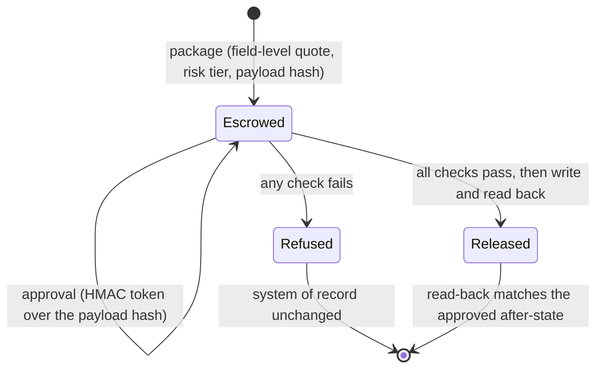

# The deterministic harness

A model can be the right tool for reading a messy request. It should never be the mechanism that
decides whether something changes. Agentic Ops Twin wraps every model-facing step in deterministic
code, and evaluates that code on its own terms.

## Layers

| Layer | What it does here | Code |
|---|---|---|
| **Feedforward guides** | Before any proposal is made, the proposer sees only a constrained world: the pack's levers with their bounds and current values, the declared demand conditions, and the names of the mandatory controls. Its output must match a strict JSON schema. | `agent/contracts.py` |
| **Compiled path first** | Known request shapes are handled by deterministic rules. If the rules cannot account for a request, it is **skipped with a reason**: either nothing matched, or a quantity in the request is unexplained by the parsed result. A skipped request escalates to a model tier or to a human queue. The rules never guess. | `agent/router.py` |
| **Model routing** | Escalation goes through tiers, cheapest first, and the first usable result is accepted. Shadow mode runs a second proposer on requests the compiled path accepted and records agreement, as evidence for promoting or retiring rules. | `agent/router.py` |
| **Computational sensors (gates)** | These checks gate every step: schema validation, the critic, control-path proofs, budget and bounds checks, number-level grounding, digest checks, approval-token checks and read-back. Every check is deterministic. | `agent/critic.py`, `simulation/validate.py`, `governance/grounding.py`, `governance/writegate.py` |
| **Inferential sensors** | These never act as gates. A model-written narrative is used only if it passes the computational grounding check; otherwise it is discarded and logged. | `governance/brief.py` |
| **Steering loop** | A proposal gets at most one repair round, driven by the critic's typed reasons. Skip and refusal reasons are stored as data, so a recurring failure becomes a harness change (a new rule, a tighter schema, a new check), not a prompt tweak. | `agent/loop.py`, ledger |
| **Model trust gate** | Before a simulated result can inform a change, the twin is classified against observed history. A history that shows mechanisms the twin omits blocks release. | `governance/trust.py` |
| **Staged write-gate** | Changes are held in escrow with a field-level quote and released only with valid approvals bound to the exact payload. The write is then read back. Any failed check is a fail-closed refusal. | `governance/writegate.py` |
| **Decision provenance graph** | An append-only, hash-chained, bi-temporal record with typed edges. Facts are invalidated rather than deleted, can be queried as of a given time, and can be exported as reconstruction packs. | `governance/ledger.py` |

## Model trust gate

The pre-registered hidden-truth study found a twin that matched history on completion rate
but was wrong about cycle times by 65–82%. Matching history is therefore not a release criterion
on its own. The gate assigns one of three statuses:

| Status | Evidence | Effect on release |
|---|---|---|
| `validated` | An observed history was checked and no residual diagnostic flagged a missing mechanism. | The standard risk tiers apply. |
| `unvalidated` | No observed history was assessed (true for the hand-authored packs). | The high-risk path applies, and every approver must explicitly acknowledge the status. |
| `inadequate` | The history shows handoff gaps, idle capacity while work waits, or non-stationary arrivals. | **Blocked.** No change package can be released. |

```bash
ops-twin dataset --pack insurance --seed 1000        # stand-in for an operational event-log export
ops-twin trust --pack insurance --arrivals <arrivals.csv> --events <events.csv>
```

## Governed write-back to a sandboxed system of record

The prototype is never connected to a live system. To show the whole control pattern from end
to end, it keeps a local JSON *system of record* holding each pack's lever-addressable
configuration.



**Risk tiers** are set by policy, not by any proposal. A package is high-risk if it does any of
the following:

- reduces the capacity of an active resource;
- switches a step to automation;
- changes staffed cost by more than 10%;
- comes from an unvalidated twin.

High-risk packages need two distinct approvers. The maker can never approve their own package.

**Release checks.** All of these must pass, or the release is refused:

- the package and its source brief are still valid;
- the payload hash matches;
- the model digest has not changed;
- the trust gate does not report `inadequate`;
- the system of record still equals the quoted "before" state;
- the approvals are enough for the tier, distinct, unexpired, signed over this exact payload,
  and not by the maker or requester;
- nothing has been released from this package before.

```bash
ops-twin reviewer add approver-a && ops-twin reviewer add approver-b
ops-twin package --pack insurance --brief <brief-id> --trust <trust-id> --maker ops-analyst
ops-twin approve --package <package-id> --reviewer approver-a --acknowledge-unvalidated
ops-twin approve --package <package-id> --reviewer approver-b --acknowledge-unvalidated
ops-twin release --pack insurance --package <package-id> --requester ops-analyst
ops-twin ledger reconstruct --record <release-id>
```

!!! warning "Illustrative identity"
    Approval keys are local secrets created by the operator, so identities are illustrative and
    not authenticated. The system of record is a local file. This demonstrates the control
    pattern; it is not a security product.

## Evaluating the harness separately from the model

`ops-twin eval-harness` runs **golden jobs** (complete governed paths that must end with a
verified write) and **negative tests**. Each negative test must produce a refusal *and* leave
the system of record byte-for-byte unchanged:

- no approval, or too few approvals;
- self-approval;
- forged tokens;
- expired tokens;
- an unacknowledged unvalidated twin;
- an inadequate twin;
- an invalidated brief;
- drift in the system of record after the quote;
- a rejection by one approver;
- replay of an already-released package;
- a request to remove a mandatory control.

`ops-twin eval-routing` reports how well the routed proposer reads requests, as three separate
counts: correct, wrong and skipped. A router cannot look accurate by guessing. Results are in
[Results](results.md).
